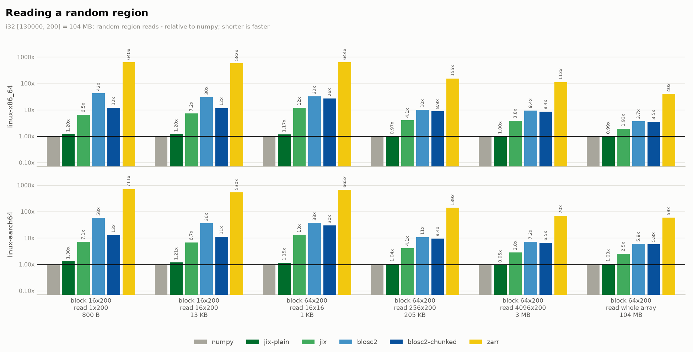

# jix

[](https://crates.io/crates/jix/)
[](https://pypi.org/project/jix/)
[](https://docs.rs/jix/latest/jix/)
[](https://jix.readthedocs.io/en/stable/)
[](https://github.com/barakugav/jix/actions/workflows/coverage.yaml)


A multi-dimensional array library with block-compressed storage and lazy-evaluated operations - written in Rust, with Python bindings.

**Block-based compression.** An array is split into a grid of fixed-size nd-blocks, each
compressed independently. On a read request for a sub-region of the array, only the blocks that
overlap the requested region are decompressed, so random access into large arrays is relatively
cheap.

**Lazy operation chains.** Every operation - arithmetic, shape change, reduction, type cast -
returns a new view that wraps the input(s) and records the transformation; nothing is computed
until data is explicitly requested. A chain of such operations builds a pipeline that runs in a
single decompression pass the moment you ask for output (read an element or a sub-region).

```rust
use std::path::Path;

use jix::Array;
use ndarray::array;

// Compress a 2-D f32 ndarray into block-compressed storage.
let a = Array::compact_ndarray(&array![[1.0f32, 2.0, 3.0], [4.0, 5.0, 6.0]])?;

// Read a single element and a sub-region. Only the blocks they touch are
// decompressed, not the whole array, so random access reads are relatively fast.
assert_eq!(a.get(&[1, 2])?, 6.0);
assert_eq!(a.to_ndarray_sub(&[0..2, 1..3])?, array![[2.0, 3.0], [5.0, 6.0]]);

// Build a lazy pipeline - no data is read yet.
// The full chain is a single static type:
//     Array<Map<Sum<Exp<Compact>>>>
let result = a.exp().sum(0).map(|x| x - 1.0);

// Materialize and persist. Blocks are decompressed, transformed,
// and re-compressed one at a time - no full copy in memory,
// not even the compressed form of the full result.
result.write_to_file(Path::new("result.jix"))?;
```

Python bindings are also available:

```python
import jix
import numpy as np

# Compress a NumPy array into block-compressed storage.
a = jix.compact(np.random.rand(1024, 1024).astype(np.float32))

# Build a lazy pipeline - nothing is read yet.
result = (a - a.mean(dim=0)) / a.std(dim=1)

# Materialize: decompress, transform, and write to disk in one pass.
result.write_to("normalized.jix")

# Load and read a single element and a sub-region. Only the blocks they touch are
# decompressed, not the whole array, so random access reads are relatively fast.
b = jix.read_array("normalized.jix")
x = b[42, 7]
rows = b[42:45, 0:10]
```

## When should I use this library?

Jix's two main features - block-compressed ndarrays and lazy operation chains -
can be used independently, and each fits a different scenario.

- **Random access to a compressed array.**
    When you want to minimize the size of an array - on disk or in memory - but still need
    to read small regions of it at a time, jix's compact arrays let you decompress just the
    blocks that overlap each read. The same applies when you have many small arrays and want
    to keep their combined footprint low.
    A classic example is a machine-learning data loader that randomly samples chunks from
    a large dataset. This use case needs only the compact array - no lazy pipeline required.
- **Reducing peak memory usage of array ops**
    Usually, in crates like `ndarray` or the `NumPy` library, a full intermediate array is
    allocated for every step in a chain of operations, which can lead to high peak memory usage.
    Jix's lazy operation chains avoid this by building a pipeline that compute each output block
    one by one, so the peak memory is bounded by O(block_size). This also has the benefit of
    better cache locality, but most of the times this alone doesn't achieve better performance
    than the common eager libraries.
- **Computation on arrays that don't fit in memory.**
    For arrays too large to hold in memory, jix's lazy operation chains let you mmap an array
    from disk, apply a pipeline of operations on top of it, and stream the result back to
    disk - without ever holding the full array in memory, not even in its compressed form.
    This use case needs only the lazy pipeline; you can build it on a plain array backed
    by an mmap'd file, without using the compact format.

### When NOT to use jix

- if you want to compress an array but always read it in full, you don't need jix at all - just
    zip and unzip the whole array with a general-purpose compressor. Although some of jix filters
    are dtype aware, so you may want to test the compression ratio and speed for your specific
    data.

## Benchmarks

[](scripts/bench/report/report.md)

jix against NumPy, Blosc2 and Zarr in Python and `ndarray` in Rust, on reads, compression,
elementwise operations, reductions and lazy chains.
See the [benchmark report](scripts/bench/report/report.md).

## Thanks

This project would not exist without the work of several upstream
authors and communities.
Specifically, this project was greatly inspired by the [C-Blosc2](https://github.com/Blosc/c-blosc2) library.
See the [`THANKS.md`](./THANKS.md) file for more details and attribution.

## License

This project is licensed under either of

- Apache License, Version 2.0 ([`LICENSE-APACHE`](./LICENSE-APACHE) or http://www.apache.org/licenses/LICENSE-2.0)
- MIT license ([`LICENSE-MIT`](./LICENSE-MIT) or http://opensource.org/licenses/MIT)

at your option.

Legal attribution and full license text for third-party components are in the [`NOTICE`](./NOTICE) file at the root of this repository.
