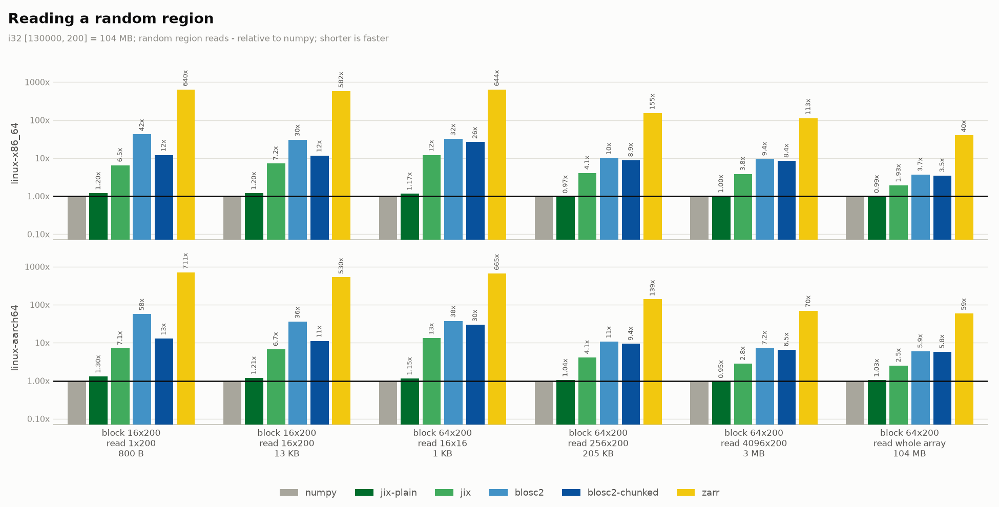

You want to read regions out of a large nd-array, fast, and minimize the memory/disk usage of the
array. Without any libraries, you have to choose between a regular Python-NumPy/Rust-ndarray array,
which is fast but memory-hungry, or a compressed format (like zip/zstd of the whole array), which
saves space but makes random access expensive as you have to decompress the entire array to read a
small region. [jix](https://github.com/barakugav/jix) is a library that comes to solve this problem
efficiently.

## 1D Blocks

So how can you be smart about it? Let's say you have a 1D array (vector), so you come up with the
idea of dividing it into blocks, of some fixed length (say 100 elements), compress each block
independently and store them in a table. When you want to read an element, you only need to
decompress the block that contains it, rather than the entire array. Cool, right?



jix uses zstd to compress each block, with additional dtype-aware filters to improve compression
efficiency.


## ND Blocks

The same idea works for N dimensions: you choose a fixed block shape (100x100 for 2D), divide the
array into blocks of that shape, compress each block independently, and store them in a table. When
you want to read a rectangular region, you compute which blocks overlap the region and only
decompress those blocks.



<div class="code-tabs" markdown="1">

```rust
use jix::Array;
use jix::storage::CompactParams;
use ndarray::{Array2, Ix2};

// A 600x800 array, cut into 100x100 blocks, each compressed on its own
let data = Array2::<f32>::from_shape_fn((600, 800), |(i, j)| (i + j) as f32);
let params = CompactParams::new().block_shape(&[100, 100])?;
let a = Array::compact_ndarray_with(&data, params)?;

// Decompresses only the 6 (out of 48) blocks that overlap the region
let region = a.to_ndarray_sub::<Ix2>(&[150..250, 380..520])?;
let x = a.get(&[599, 0])?; // a single element, a single block
```

```python
import jix
import numpy as np

# A 600x800 array, cut into 100x100 blocks, each compressed on its own
data = np.random.rand(600, 800).astype(np.float32)
a = jix.compact(data, params={"block_shape": [100, 100]})

# Decompresses only the 6 (out of 48) blocks that overlap the region
region = a[150:250, 380:520]  # a np.ndarray
x = a[599, 0]  # a single element, a single block
```

</div>

Congrats! You now have a block-compressed array that allows efficient random access to any region
without decompressing the entire array. This is jix's `Compact` storage, and you can support any
indexing reads to it.

This alone is one of the main goals of jix: efficient random access to large arrays without
decompressing them entirely. A classical use case is a machine learning dataloader that samples a
random sample out of a large dataset, for example a random audio or weather measurement segment out of
a long recording. The next sections are focused on operations, but the `Compact` storage alone can
benefit many use cases on its own.


## Elementwise Operations

Suppose that you have two block-compressed arrays of the same shape and dtype, `a` and `b`, and you
want to perform element-wise addition `a+b` between them. A naive approach will decompress `a`,
decompress `b`, then call NumPy or Rust's ndarray to perform the addition on the fully decompressed
arrays, and compress the output again. This works, but we can do better than that! We iterate on
matching blocks in `a`,`b`, and the output, decompressing + processing + compressing one block at
a time. This way, we never hold the fully decompressed arrays in memory, and we only touch the
blocks that are actually needed for the computation.



<div class="code-tabs" markdown="1">

```rust
let a = Array::compact_ndarray(&data_a)?;
let b = Array::compact_ndarray(&data_b)?;

// Block by block: decompress a block of `a` and of `b`, add, compress the sum
let c = (a + b).compact()?;
```

```python
a = jix.compact(data_a)
b = jix.compact(data_b)

# Block by block: decompress a block of `a` and of `b`, add, compress the sum
c = (a + b).compact()
```

</div>


## Elementwise Operation Chains

Now suppose that you have three block-compressed arrays, instead of two, all of the same shape and
dtype, `a`, `b`, and `c`, and you want to perform `(a+b)*c`. Using the approach above naively, we
iterate block by block of `a+b` and decompress, process and compress, and then again iterate block
by block of the intermediate result `(a+b)` and `c` to decompress and compute `(a+b)*c` and compress
again. This works, but it's wasteful. A better approach is to "fuse" the chain, iterate over blocks
of `a`, `b`, and `c` simultaneously, compute `(a+b)*c` block by block, and compress once. For this,
our execution model must become lazy, because `a+b` doesn't "know" `c` is going to multiply the
result. In jix, every operation is lazy, so `a+b` is of type `Array<Add<Compact, Compact>>` and
`(a+b)*c` is of type `Array<Mul<Add<Compact, Compact>, Compact>>`. Lazy arrays can be materialized
into new block-compressed arrays (`.compact() -> Array<Compact>`) or into standard in-memory arrays
(Python `.numpy() -> np.ndarray` or Rust `.to_ndarray() -> ndarray::ArrayD<T>`).



<div class="code-tabs" markdown="1">

```rust
// Nothing is computed yet, `expr` is a lazy view of type
// Array<Mul<Add<Compact<f32>, Compact<f32>>, Compact<f32>>>
let expr = (a + b) * c;

let out = expr.compact()?; // one fused pass, compress once
let arr = expr.to_ndarray::<Ix2>()?; // or into an in-memory ndarray
let part = expr.to_ndarray_sub::<Ix2>(&[0..10, 0..10])?; // or compute only a region
expr.write_to_file(Path::new("out.jix"))?; // or write to a compressed .jix file
```

```python
expr = (a + b) * c  # lazy, nothing is computed yet

out = expr.compact()  # one fused pass, compress once
arr = expr.numpy()  # or into a NumPy array
part = expr[0:10, 0:10]  # or compute only a region
expr.write_to("out.jix")  # or write to a compressed .jix file
```

</div>


## Generic Storage and Non-Elementwise Operations

jix arrays are built on a generic abstract `Storage` which has a main function
`read_data(sub_region)`. Lazy elementwise operations implement this function by reading the
corresponding sub-regions from their input arrays and applying the operation block by block, but you
can imagine how `broadcast`, `insert_dim`, `permute_dims`, and even `reshape` can be implemented
lazily as well - every such op does some playing around with the sub-region coordinates before
calling once or more to the inner (original) storage.

Reduction ops are also lazy. For example for an array `a` of shape `(100, 40)`, the lazy array
`a.sum(axis=0)` is a lazy array of shape `(40,)` that implements `read_data` by reading the larger
corresponding sub-region from `a` and summing along the first axis. A reduction op may split the
inner read to small read operations to keep the peak memory usage low.

jix supports elementwise operations, reductions, shape ops, concat/stack, and more, all as lazy
views.



<div class="code-tabs" markdown="1">

```rust
let a = Array::compact_ndarray(&data)?; // shape [100, 40]

let s = a.view().sum(0); // shape [40]
let part = s.to_ndarray_sub::<Ix1>(&[10..20])?; // reads only a[0..100, 10..20]

let t = a.view().permute_dims(&[1, 0]); // shape [40, 100]
let r = a.view().reshape(&[20, 200]); // shape [20, 200]
let both = jix::ops::concatenate([a.view(), a.view()], 0); // shape [200, 40]

// Still lazy: mean, insert_dim, broadcast and sub run block by block on read
let mean = a.view().mean(0).insert_dim(0).broadcast(&[100, 40]);
let centered = (a.view() - mean).compact()?;
```

```python
a = jix.compact(data)  # shape (100, 40)

s = a.sum(dim=0)  # shape (40,)
part = s[10:20]  # reads only a[0:100, 10:20]

t = a.T  # shape (40, 100)
r = a.reshape((20, 200))  # shape (20, 200)
both = jix.concat([a, a], dim=0)  # shape (200, 40)

# Still lazy: mean, broadcasting and sub run block by block on read
centered = (a - a.mean(dim=0)).compact()
```

</div>


## Processing arrays larger than RAM

A cool unlock of the lazy evaluation model is that it allows us to process very large arrays, even if
they are bigger than RAM (even in their compressed form). The way you would go about it, is if you
have a large array saved to disk, whether a plain buf or in `.jix` compressed format, you can load
the array using memory map, build a pipeline of operations, and write the result back to disk
directly. The pipeline will run block by block, never materializing the entire array into RAM.

<div class="code-tabs" markdown="1">

```rust
use jix::Array;
use jix::dtype::Dtyped;
use jix::storage::ArchiveValidation;

// A .jix file, memory mapped: blocks are paged in only when read.
let path = Path::new("huge.jix");
let len = std::fs::metadata(path)?.len();
// Safety: the file is not modified while `src` is alive
let src = unsafe { Array::read_from_file_mmap(path, 0, len, ArchiveValidation::default())? };

// Build a pipeline and stream it to disk, one block at a time
let out = src.into_typed::<f32>()?.exp().map(|x| x * 0.5);
out.write_to_file(Path::new("out.jix"))?;

// A raw f32 file of shape [rows, 200], memory mapped, no copy
let file = std::fs::File::open("huge.f32")?;
let mmap = unsafe { memmap2::Mmap::map(&file)? };
// Safety: the file holds rows*200 f32 values and outlives `src`
let src = unsafe {
    jix::PlainArrayView::<f32>::plain_ndarray_ptr(
        mmap.as_ptr(),
        &[rows, 200],
        &[200 * 4, 4], // strides in bytes
        f32::DTYPE,
    )?
};
src.sum(1).write_to_file(Path::new("row_sums.jix"))?;
```

```python
# A .jix file, memory mapped: blocks are paged in only when read
src = jix.read_array("huge.jix", mmap=True)
out = src.exp() * 0.5
out.write_to("out.jix")  # streamed to disk, one block at a time

# A raw f32 file, memory mapped by NumPy; jix wraps it without a copy
raw = np.memmap("huge.f32", dtype=np.float32, mode="r", shape=(rows, 200))
src = jix.asarray(raw)
src.sum(dim=1).write_to("row_sums.jix")
```

</div>


## Performance

A cliche, but I can easily fill a couple of full blog posts on performance optimizations. This was
easily 75% of the time I developed the library, finding more and more ways NumPy is smarter than me
and battle tested. I'll list a few buzzwords:
- Specialized inner loops for different contiguous/strided arrays, for example jix has 4 different
  implementations for the `Add` operation (not counting SIMD variants), depending on the inputs and
  output layout: `<all-contiguous/any-strided for inputs> x <contiguous/strided for output>`.
  The variants are the same function with generics of course, but the Python
  wheels contain all pre-compiled versions.
- SIMD kernels for vectorized operations, using
  [fearless_simd](https://github.com/linebender/fearless_simd).
- Caching decompressed blocks of arrays that appear more than once in the same expression, like
  `(x+y)*x`.
- Iterating over nd-arrays is done after merging degenerate dims (length 1) and sorting the
  remaining dimensions so that the inner loops have a small stride and better cache locality. This is
  done in all elementwise ops, reductions, and general nd-copy. You will be surprised, but Rust
  `ndarray` doesn't do that, except for special cases (contiguous, C-order, F-order, etc.).

And many, many other small optimizations, such as examining asm and llvm-mca to understand why the
compiler doesn't do what I want, doing weird tricks to reduce binary size and compile times,
minimizing overhead using Callgrind with fast paths for small reads, etc.
The fact that the mainstream library for this kind of data
structure, blosc2, is (mostly) using NumPy under the hood for its expression engine, forced me to
optimize the library again and again just to achieve a close to comparable runtime. Honestly, this
was quite a journey and it made me value NumPy much more, seeing the level of optimization and
thought that went into it, even when its basic concept and ndarray is pretty straightforward (it's
just a shape, data pointer and strides, how hard could it be, right??).

The [benchmark report](https://github.com/barakugav/jix/blob/f85a47beaf8d34082dbcc554876ea8a7f3d38a53/scripts/bench/report/report.md)
compares jix against a few libraries in Python and Rust, on reads, compression, elementwise ops,
reductions and lazy chains, etc. For example, reading a random region:

<figure>
<a href="https://github.com/barakugav/jix/blob/f85a47beaf8d34082dbcc554876ea8a7f3d38a53/scripts/bench/report/report.md"></a>
<figcaption>Time to read a random region, relative to NumPy (lower is faster). From the <a href="https://github.com/barakugav/jix/blob/f85a47beaf8d34082dbcc554876ea8a7f3d38a53/scripts/bench/report/report.md">benchmark report</a>.</figcaption>
</figure>

## Thanks and misc

I didn't invent any of these ideas from scratch, and specifically I want to say a huge thanks to
[c-blosc2](https://github.com/Blosc/c-blosc2) for developing these approaches and mastering a lot of
it. jix can be seen as a port of ideas and natural evolution of these concepts, both to Rust (over
C) and for specific design and performance choices.

I use AI freely, in a way I judge as reasonable and helpful for my work. This project is far, far,
from AI slop, and I'm afraid to admit how many hours I put into it. I used AI mostly for scripts,
benches, quick experiments, docs and large refactors, and since Opus 5.5 I use it more freely. If
you want to judge for yourself, take a look at the commits.

If you want to use the library, you can find it on [crates.io](https://crates.io/crates/jix/) and
[PyPI](https://pypi.org/project/jix/). If you have any feedback, questions or
requests, feel free to reach out to me *barakugav@gmail.com* or open an issue on the [GitHub
repository](https://github.com/barakugav/jix).
