*Measured on linux-x86_64 (AMD EPYC 7763 64-Core Processor), linux-aarch64 (Neoverse-N2). Benched commit `e72a2500`. GitHub run [44948445474](https://github.com/barakugav/jix/actions/runs/44948445474).*

# jix benchmarks

jix is a multi-dimensional array library with block-compressed storage and lazy operation chains.
This page measures both against the libraries you would otherwise reach for: `ndarray` in Rust,
NumPy, Blosc2 and Zarr in Python.

- **Machines**: GitHub-hosted runners - `linux-x86_64`: AMD EPYC 7763 64-Core Processor, 4 cores, 16 GB RAM, Ubuntu 26.04.1 LTS; `linux-aarch64`: Neoverse-N2, 4 cores, 16 GB RAM, Ubuntu 26.04.1 LTS.
rustc 1.100.0, Python 3.14.4, numpy 2.5.5, blosc2 4.15.0, zarr 3.4.2.

- **Single threaded**: all benchmarks are run with a single thread to ensure a fair comparison across libraries.

- **Codec settings are matched** across jix, Blosc2 and Zarr: zstd level 3, byte-shuffle.
The array is `[130000, 200]` in Rust and Python - 104 MB as `i32/f32`.

Most plots show each library's speed relative to NumPy (or `ndarray` in Rust), whose bar tops out
on the `1x` line, so higher is always better: a bar above the line is faster, a bar below it is
slower, by the multiple printed on the bar.

In plots, the `jix` and `blosc2` labels always mean the byte-shuffled variant - the default for both libs, the configuration most people would actually
use. The unfiltered variants appear only in the compression section, where the filter is the thing
being measured. `jix-plain` is jix over an ordinary uncompressed in-memory buffer: it isolates the
cost of jix's operation machinery from the cost of decompression.

---

## Reading a region

Read a random region (of different sizes) out of a large array without decompressing the whole thing.

#### Python

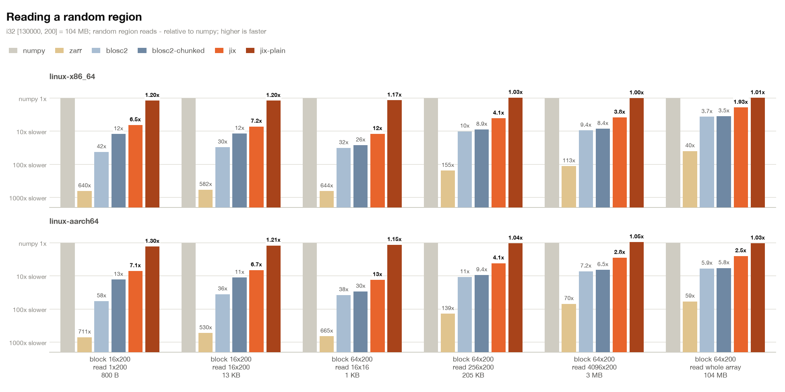

- NumPy is the baseline, we read a slice and `.copy()`
- `block 64x200 / read 16x16` means the arrays are compressed with blocks of shape 64x200 each, and we read sub-regions of shape 16x16.
- `blosc2-chunked` is Blosc2 with `chunks` forced equal to `blocks`, and `blosc2` left to choose for itself (which is what we use for other benchmarks).

Absolute numbers

| case | numpy | zarr | blosc2 | blosc2-chunked | jix | jix-plain |
|---|---|---|---|---|---|---|
| block 16x200 read 1x200 800 B | 723 ns +/- 256.75 | 462.66 us +/- 39.17 | 30.57 us +/- 3.84 | 8.80 us +/- 1.99 | 4.71 us +/- 0.92 | 865 ns +/- 327.99 |
| block 16x200 read 16x200 13 KB | 1.17 us +/- 0.38 | 678.69 us +/- 74.77 | 35.51 us +/- 2.79 | 13.72 us +/- 2.08 | 8.39 us +/- 1.52 | 1.40 us +/- 0.43 |
| block 64x200 read 16x16 1 KB | 833 ns +/- 323.37 | 536.42 us +/- 105.74 | 26.59 us +/- 6.59 | 22.01 us +/- 6.94 | 9.98 us +/- 3.18 | 971 ns +/- 329.87 |
| block 64x200 read 256x200 205 KB | 9.30 us +/- 1.52 | 1.44 ms +/- 0.14 | 93.63 us +/- 6.85 | 82.39 us +/- 5.33 | 38.03 us +/- 3.03 | 9.03 us +/- 1.32 |
| block 64x200 read 4096x200 3 MB | 120.46 us +/- 11.66 | 13.59 ms +/- 0.79 | 1.14 ms +/- 0.03 | 1.01 ms +/- 0.02 | 462.35 us +/- 12.69 | 120.50 us +/- 12.15 |
| block 64x200 read whole array 104 MB | 10.79 ms +/- 0.44 | 426.97 ms +/- 16.09 | 39.61 ms +/- 1.55 | 37.80 ms +/- 0.40 | 20.79 ms +/- 0.63 | 10.66 ms +/- 0.66 |

---

#### Rust

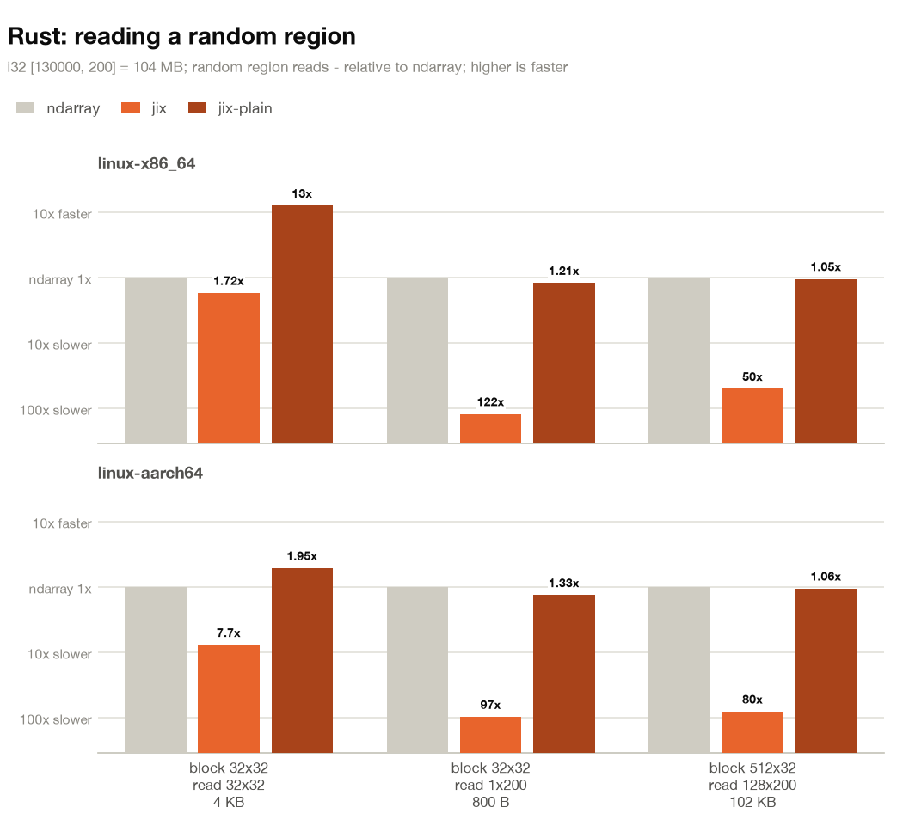

Absolute numbers

| case | ndarray | jix | jix-plain |
|---|---|---|---|
| block 32x32 read 32x32 4 KB | 5.63 us +/- 0.03 | 9.68 us +/- 0.03 | 447 ns +/- 7.56 |
| block 32x32 read 1x200 800 B | 135 ns +/- 0.28 | 16.45 us +/- 0.02 | 163 ns +/- 0.23 |
| block 512x32 read 128x200 102 KB | 5.06 us +/- 0.04 | 254.33 us +/- 0.25 | 5.30 us +/- 0.02 |

---

## Compression

#### compression size

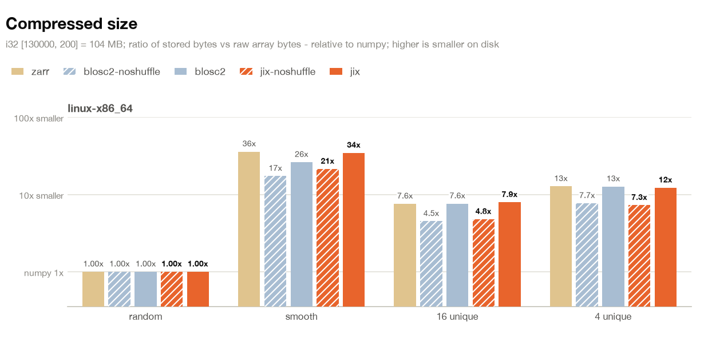

Absolute numbers

| case | numpy | zarr | blosc2-noshuffle | blosc2 | jix-noshuffle | jix |
|---|---|---|---|---|---|---|
| random | 1.0x smaller | 1.0x smaller | 1.0x smaller | 1.0x smaller | 1.0x smaller | 1.0x smaller |
| smooth | 1.0x smaller | 35.9x smaller | 17.3x smaller | 26.2x smaller | 21.4x smaller | 34.5x smaller |
| 16 unique | 1.0x smaller | 7.6x smaller | 4.5x smaller | 7.6x smaller | 4.8x smaller | 7.9x smaller |
| 4 unique | 1.0x smaller | 12.7x smaller | 7.7x smaller | 12.7x smaller | 7.3x smaller | 12.2x smaller |

---

#### compression speed

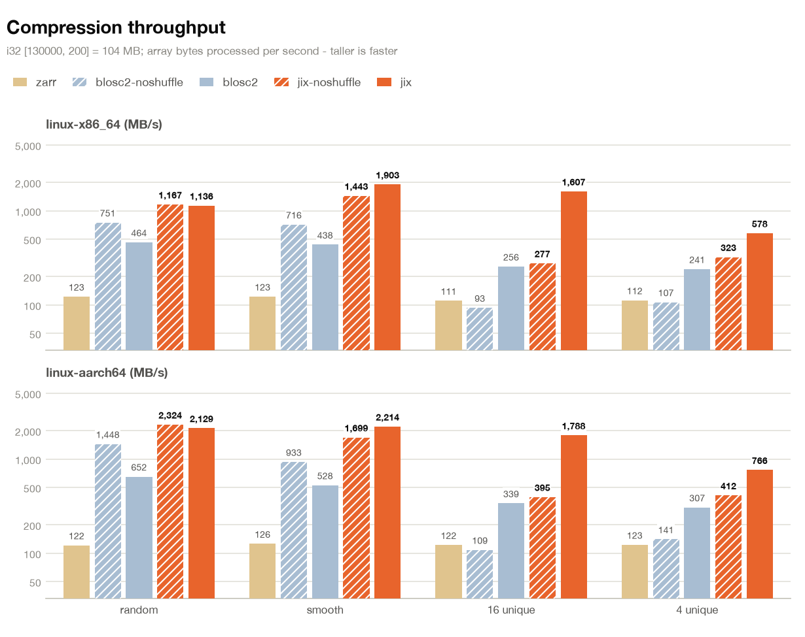

- note that when we use the byte shuffle filter the compression speed *increases*, although we do an additional step, thats because zstd is able to compress better and faster when there are many consecutive similar bytes.

Absolute numbers

| case | zarr | blosc2-noshuffle | blosc2 | jix-noshuffle | jix |
|---|---|---|---|---|---|
| random | 848 ms +/- 11.58 | 138 ms +/- 1.71 | 224 ms +/- 1.32 | 89 ms +/- 2.10 | 92 ms +/- 1.09 |
| smooth | 846 ms +/- 20.80 | 145 ms +/- 0.63 | 238 ms +/- 0.60 | 72 ms +/- 0.49 | 55 ms +/- 0.36 |
| 16 unique | 938 ms +/- 13.82 | 1114 ms +/- 4.34 | 406 ms +/- 2.66 | 375 ms +/- 3.86 | 65 ms +/- 0.77 |
| 4 unique | 926 ms +/- 11.80 | 971 ms +/- 2.96 | 432 ms +/- 1.80 | 322 ms +/- 0.45 | 180 ms +/- 1.07 |

---

## Unary Op - Negate

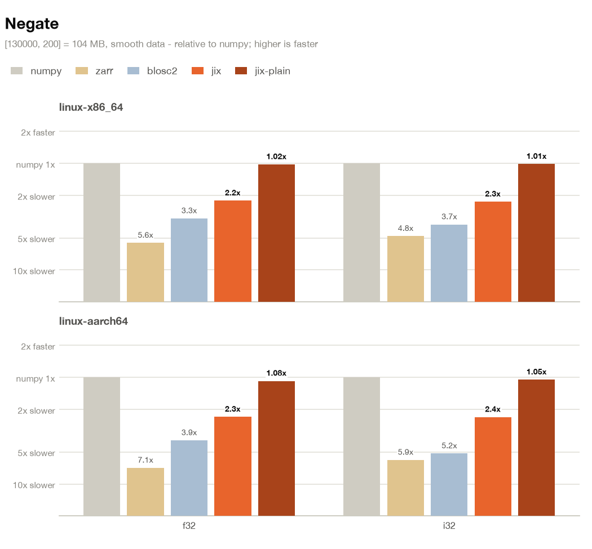

Absolute numbers

| case | numpy | zarr | blosc2 | jix | jix-plain |
|---|---|---|---|---|---|
| f32 | 10.70 ms +/- 0.50 | 59.62 ms +/- 1.81 | 35.10 ms +/- 0.28 | 23.92 ms +/- 0.33 | 10.92 ms +/- 0.33 |
| i32 | 11.36 ms +/- 0.70 | 54.60 ms +/- 1.06 | 42.45 ms +/- 0.31 | 25.97 ms +/- 1.03 | 11.51 ms +/- 0.78 |

---

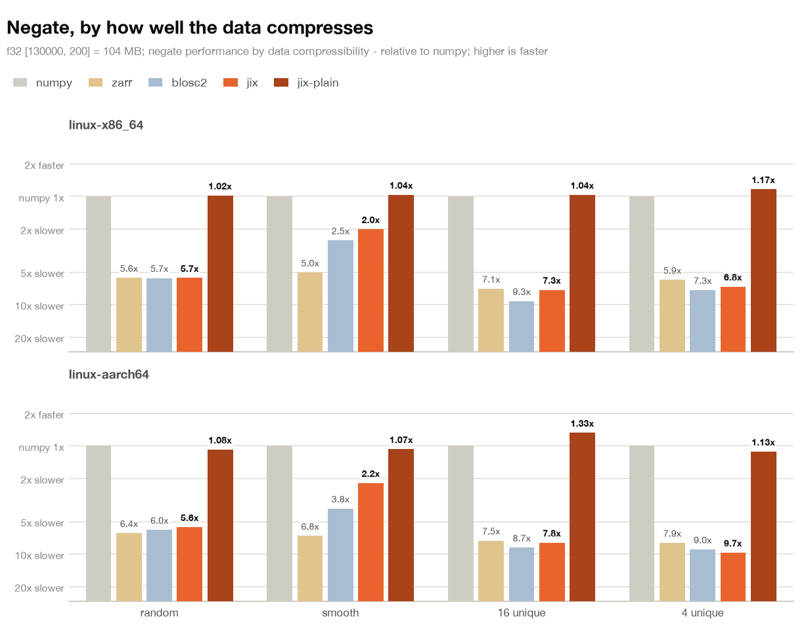

Absolute numbers

| case | numpy | zarr | blosc2 | jix | jix-plain |
|---|---|---|---|---|---|
| random | 11.89 ms +/- 0.95 | 67.06 ms +/- 1.83 | 67.38 ms +/- 0.38 | 67.30 ms +/- 1.23 | 11.63 ms +/- 0.61 |
| smooth | 12.62 ms +/- 0.74 | 63.52 ms +/- 1.28 | 32.03 ms +/- 0.48 | 25.31 ms +/- 1.57 | 12.15 ms +/- 0.64 |
| 16 unique | 12.21 ms +/- 0.47 | 86.86 ms +/- 3.58 | 112.95 ms +/- 2.29 | 88.92 ms +/- 0.64 | 11.76 ms +/- 0.60 |
| 4 unique | 14.08 ms +/- 1.71 | 82.79 ms +/- 6.29 | 102.98 ms +/- 0.27 | 95.86 ms +/- 0.40 | 12.04 ms +/- 0.33 |

---

## Binary Op - Add

Absolute numbers

| case | numpy | zarr | blosc2 | jix | jix-plain |
|---|---|---|---|---|---|
| f32 | 14.38 ms +/- 0.45 | 115.28 ms +/- 3.12 | 57.53 ms +/- 0.45 | 39.37 ms +/- 1.18 | 14.92 ms +/- 1.09 |
| i32 | 13.86 ms +/- 1.28 | 109.77 ms +/- 3.15 | 67.44 ms +/- 0.42 | 38.10 ms +/- 0.34 | 14.62 ms +/- 0.73 |

---

## Reductions

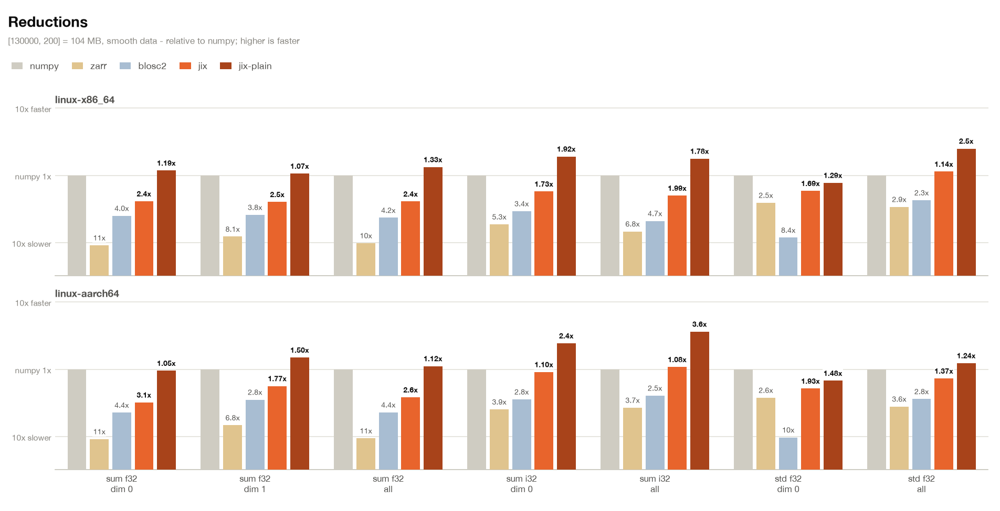

Absolute numbers

| case | numpy | zarr | blosc2 | jix | jix-plain |
|---|---|---|---|---|---|
| sum f32 dim 0 | 7.21 ms +/- 0.19 | 78.43 ms +/- 4.25 | 28.58 ms +/- 0.81 | 17.41 ms +/- 0.56 | 6.08 ms +/- 0.19 |
| sum f32 dim 1 | 8.23 ms +/- 0.55 | 66.56 ms +/- 1.41 | 31.58 ms +/- 1.31 | 20.37 ms +/- 0.67 | 7.72 ms +/- 0.17 |
| sum f32 all | 6.52 ms +/- 0.16 | 65.82 ms +/- 2.26 | 27.62 ms +/- 0.68 | 15.86 ms +/- 0.23 | 4.89 ms +/- 0.19 |
| sum i32 dim 0 | 11.67 ms +/- 0.20 | 61.97 ms +/- 1.74 | 39.53 ms +/- 0.76 | 20.17 ms +/- 0.30 | 6.09 ms +/- 0.18 |
| sum i32 all | 8.66 ms +/- 0.20 | 58.61 ms +/- 2.95 | 41.00 ms +/- 1.45 | 17.26 ms +/- 0.26 | 4.88 ms +/- 0.20 |
| std f32 dim 0 | 33.88 ms +/- 2.27 | 86.05 ms +/- 1.98 | 283.75 ms +/- 3.13 | 57.39 ms +/- 0.14 | 43.54 ms +/- 0.44 |
| std f32 all | 28.81 ms +/- 1.30 | 84.19 ms +/- 1.23 | 67.19 ms +/- 2.30 | 25.24 ms +/- 0.22 | 11.49 ms +/- 0.05 |

## Rust Ops

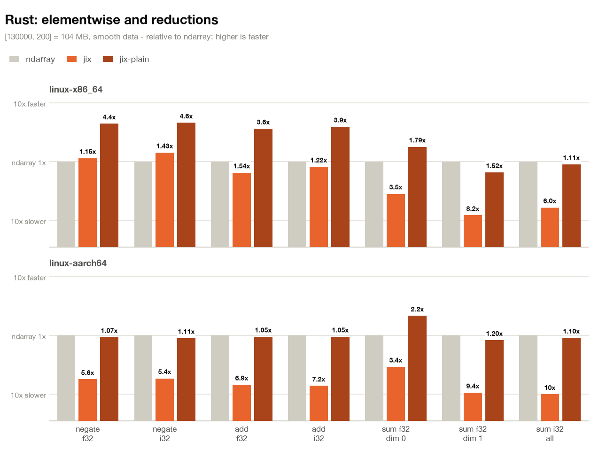

Absolute numbers

| case | ndarray | jix | jix-plain |
|---|---|---|---|
| negate f32 | 59.66 ms +/- 0.14 | 51.90 ms +/- 0.09 | 13.47 ms +/- 0.06 |
| negate i32 | 60.76 ms +/- 0.33 | 42.51 ms +/- 0.14 | 13.21 ms +/- 0.04 |
| add f32 | 61.05 ms +/- 0.11 | 93.75 ms +/- 0.15 | 16.76 ms +/- 0.07 |
| add i32 | 61.37 ms +/- 0.10 | 74.77 ms +/- 0.07 | 15.57 ms +/- 0.11 |
| sum f32 dim 0 | 12.23 ms +/- 0.04 | 42.91 ms +/- 0.06 | 6.81 ms +/- 0.05 |
| sum f32 dim 1 | 5.49 ms +/- 0.04 | 44.93 ms +/- 0.05 | 8.36 ms +/- 0.08 |
| sum i32 all | 5.41 ms +/- 0.03 | 32.52 ms +/- 0.08 | 5.99 ms +/- 0.03 |

---

## Operation chains

Every step is a binary operation over two source arrays, starting from `a*a`.
Every jix operation returns a lazy view, the whole chain is encoded in the type and runs in a
single pass when output is requested. NumPy and `ndarray` make a full pass per step, so the gap
should widen as the chain gets longer.

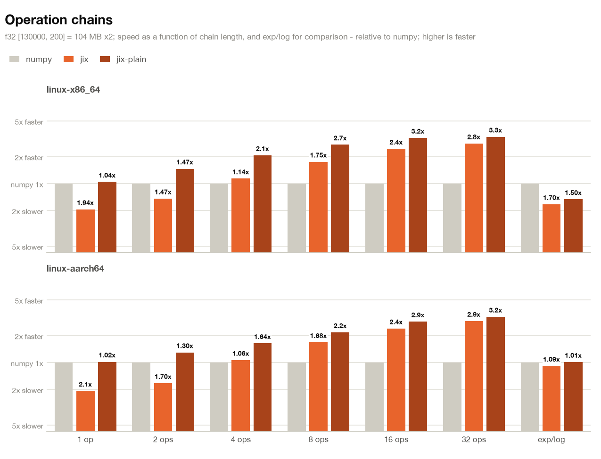

- jix is faster than numpy here for long chains of operations because of less memory traffic.
numpy allocates an intermediate full array for each step while jix apply the chain sub region
at a time.
- The `exp/log` case, which compute `log(exp(a) + exp(b))`, is an example in which the math op itself is the bottle neck and fusing does not help.

Absolute numbers

| case | numpy | jix | jix-plain |
|---|---|---|---|
| 1 op | 13.48 ms +/- 0.58 | 26.13 ms +/- 0.37 | 12.91 ms +/- 0.52 |
| 2 ops | 29.67 ms +/- 1.54 | 43.65 ms +/- 0.57 | 20.25 ms +/- 0.77 |
| 4 ops | 61.00 ms +/- 1.51 | 53.67 ms +/- 0.57 | 29.47 ms +/- 1.02 |
| 8 ops | 125.26 ms +/- 2.64 | 71.49 ms +/- 0.59 | 46.07 ms +/- 0.50 |
| 16 ops | 260.39 ms +/- 8.60 | 106.50 ms +/- 0.57 | 80.37 ms +/- 1.03 |
| 32 ops | 488.82 ms +/- 16.44 | 174.47 ms +/- 0.54 | 146.72 ms +/- 0.54 |
| exp/log | 140.01 ms +/- 0.79 | 238.48 ms +/- 2.78 | 209.83 ms +/- 0.14 |

---

### Peak memory

Peak RSS memory while ignoring the input and output arrays.

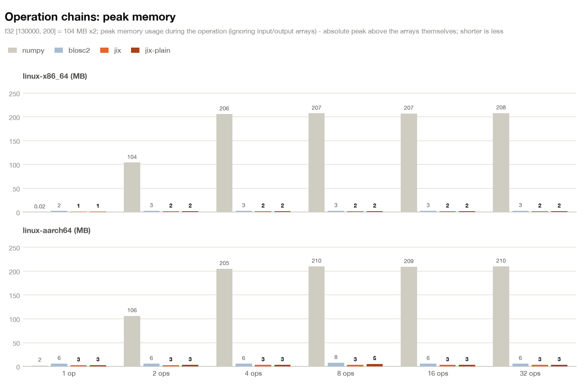

- numpy allocates full intermediate arrays for each step. While jix and blosc operate in chunks.

Absolute numbers

| case | numpy | blosc2 | jix | jix-plain |
|---|---|---|---|---|
| 1 op | 0.0 MB | 2.4 MB | 1.3 MB | 1.3 MB |
| 2 ops | 104.0 MB | 2.6 MB | 1.8 MB | 1.8 MB |
| 4 ops | 205.9 MB | 2.6 MB | 1.9 MB | 1.8 MB |
| 8 ops | 207.3 MB | 2.6 MB | 1.9 MB | 1.8 MB |
| 16 ops | 207.2 MB | 2.7 MB | 1.9 MB | 1.8 MB |
| 32 ops | 208.0 MB | 2.8 MB | 1.9 MB | 1.8 MB |

---

### Rust

In rust operations are fused by the compiler.

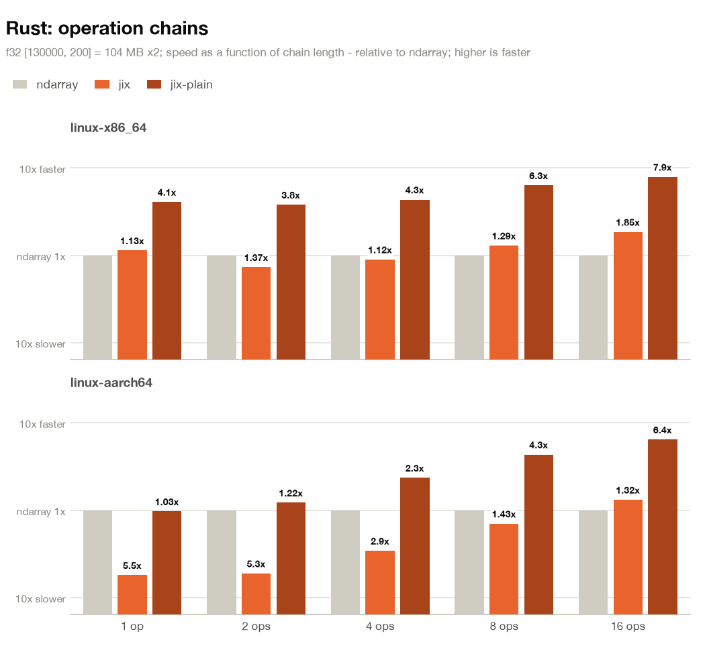

Absolute numbers

| case | ndarray | jix | jix-plain |
|---|---|---|---|
| 1 op | 59.39 ms +/- 0.08 | 52.36 ms +/- 0.19 | 14.56 ms +/- 0.05 |
| 2 ops | 68.88 ms +/- 0.17 | 94.51 ms +/- 0.35 | 18.17 ms +/- 0.14 |
| 4 ops | 86.07 ms +/- 0.78 | 96.23 ms +/- 0.25 | 19.87 ms +/- 0.12 |
| 8 ops | 128.86 ms +/- 0.50 | 99.82 ms +/- 0.15 | 20.41 ms +/- 0.12 |
| 16 ops | 201.45 ms +/- 1.57 | 109.05 ms +/- 0.23 | 25.55 ms +/- 0.07 |

---

## A reduction inside a broadcast

`a / a.std(dim)` - this is a case in which laziness hurt performance pretty badly.
`a / a.std(dim).plain()` could help.

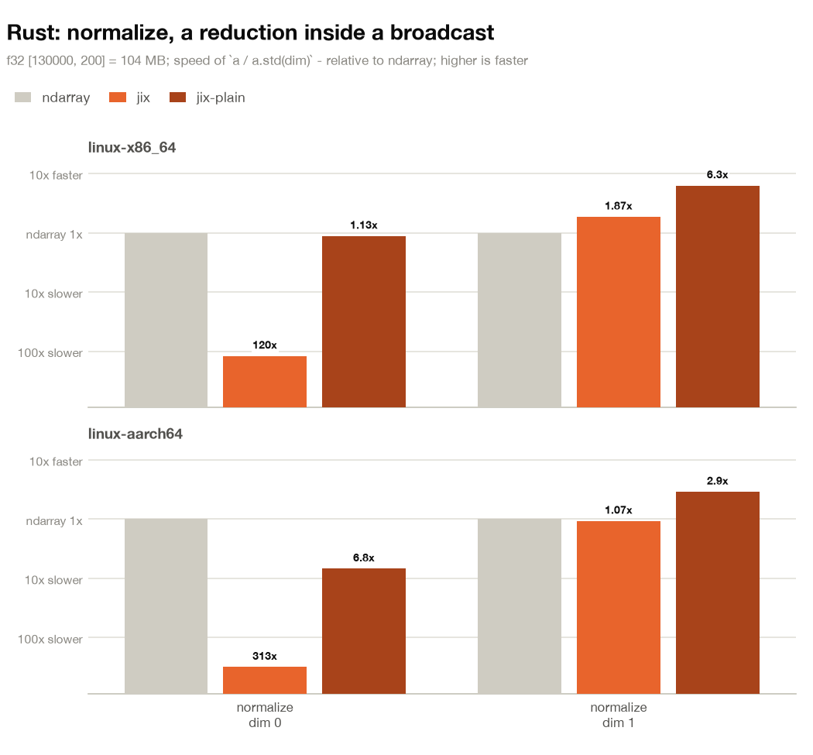

Absolute numbers

| case | ndarray | jix | jix-plain |
|---|---|---|---|
| normalize dim 0 | 137.89 ms +/- 0.63 | 16.53 s +/- 0.01 | 155.67 ms +/- 3.73 |
| normalize dim 1 | 205.34 ms +/- 1.53 | 109.74 ms +/- 0.23 | 32.60 ms +/- 0.06 |

---

## Dim order

jix orders the loops by the operands' strides, so any layout runs as a flat walk through memory.
ndarray has a fast path for C and F layouts only: a binary op on any other layout, such as a
`[0,2,1]` permutation, walks the last logical axis whatever its stride.

- C: both libraries run one flat loop.
- `[0,2,1]`: ndarray jumps a full row per element.
- `-a` on `[0,2,1]`: ndarray's unary `map` checks contiguity in memory order, so any permutation
  of a contiguous array is fast. It needs a sliced view to lose it.

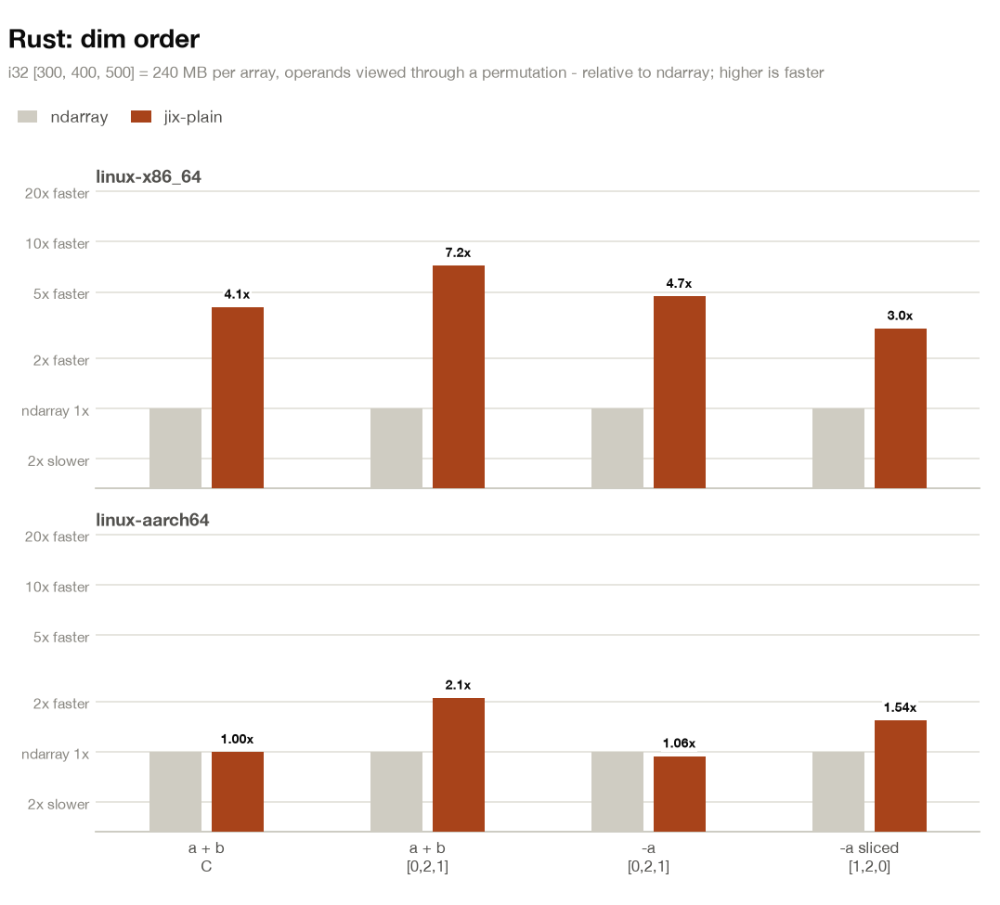

Absolute numbers

| case | ndarray | jix-plain |
|---|---|---|
| a + b C | 140.47 ms +/- 0.17 | 34.66 ms +/- 0.31 |
| a + b [0,2,1] | 252.05 ms +/- 1.28 | 35.05 ms +/- 0.46 |
| -a [0,2,1] | 134.47 ms +/- 0.32 | 28.60 ms +/- 0.55 |
| -a sliced [1,2,0] | 84.03 ms +/- 0.28 | 27.84 ms +/- 0.20 |

## Reproducing

    python jix/benches/run.py --report          # rust, only the comparison benches
    python jix-py/python/benches/run_all.py     # python

Also see [`CI.md`](../CI.md) and `scripts/bench/compare.py`.
